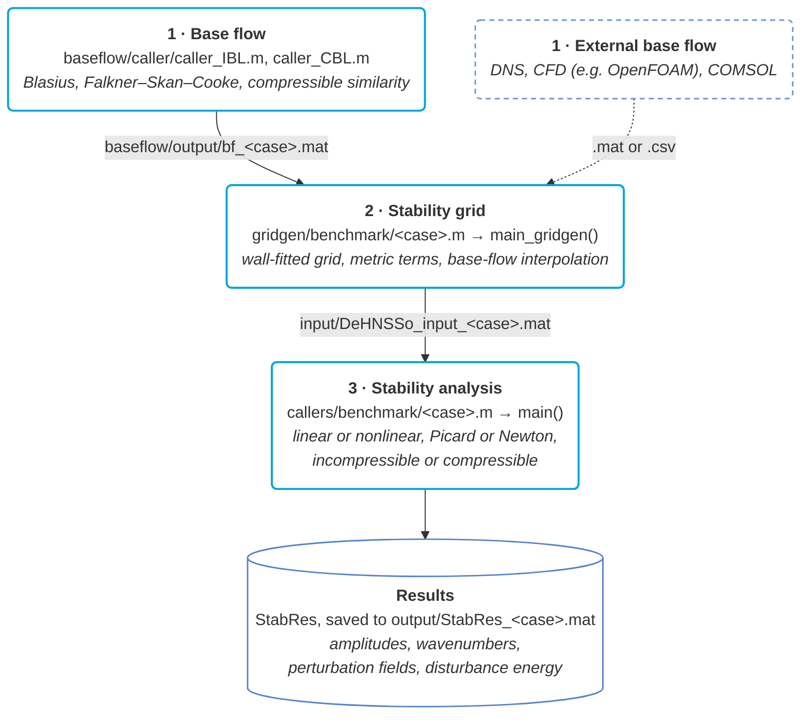

<p align="center">
  
</p>

# DeHNSSo-v2

[](https://www.mathworks.com/products/matlab.html)
[](LICENSE)
[](docs/DeHNSSo_guide.md)
[](https://doi.org/10.1016/j.cpc.2024.109250)
[](#)
[](docs/DeHNSSo_guide.md)
[](src/external/)
[](docs/DeHNSSo_guide.md)

**Harmonic Navier–Stokes stability analysis** of incompressible and compressible boundary layers over curved and featured surfaces.

DeHNSSo-v2 is an extended and refactored version of [DeHNSSo-v1](https://github.com/SvenWesterbeek/DeHNSSo) by Westerbeek, Hulshoff, Schuttelaars & Kotsonis (2024).

> **First draft (September 2026), paper in preparation.** For questions about the method or implementation, contact **Pietro Carlo Boldini** — P.C.Boldini@tudelft.nl

To be notified of new versions, watch this repository on GitHub (Watch → Custom → Releases).

**Last updated:** 5 October 2026

---

## Features

- **Grid generation** (`gridgen/`): builds the stability grid from an analytic base flow, a
  structured CFD field, or an unstructured CFD scatter (e.g. OpenFOAM), with streamwise
  clustering around surface features and an elliptic smoother for concave walls
- **Curvilinear coordinates**: perturbation equations in body-fitted coordinates (ξ, η) with
  numerically computed inverse metrics, for curved walls and surface features
- **Compressible flows**: (u, v, w, ρ, T) formulation for a calorically perfect gas with
  Sutherland viscosity, a compressible similarity base-flow solver, and compressible local
  stability at the inflow (`Opt.compressible = 'on'`)
- **Boundary conditions**: freestream condition per component, wall forcing (blowing and
  suction), freestream forcing, a Helmholtz-resonator admittance condition at the wall
  (`Opt.hr`), and an embedded boundary for steps
- **Inflow**: local stability (`'ILST'`, `'CLST'`), linear PSE (`'PSE'`), a previous
  solution (`'LOAD'`), or no inflow disturbance for forcing-only cases (`'ZERO'`)
- **Nonlinear solvers**: Picard iteration with amplitude continuation, damping, and optional
  Anderson acceleration; Newton pseudo-arclength continuation with MUMPS for high amplitudes
  (`Opt.solver = 'newton'`)
- **Linear solvers** (`Opt.lu_mode`): sparse LU with a bounded factor cache (`'auto'`,
  default), with all factors kept (`'full'`) or none kept (`'seq'`), banded LAPACK LU
  (`'lapack_band'`), and a block-Thomas solver with optional out-of-core storage
  (`'block_thomas'`)
- **Efficiency**: assembly of linear cost in the number of streamwise stations, reuse of the
  factorizations over the nonlinear iterations and over runs (`Opt.rerun`), and optional
  parallel solves (`Opt.parfor`). On the nonlinear test cases of DeHNSSo-v1, DeHNSSo-v2 is
  9 to 19 times faster (see Sec. 7 of the DeHNSSo-v2 paper)
- **Resolvent analysis** of a single mode, incompressible (`src/hns/resolvent.m`)

## Sample run

The folder `sample/` contains a complete test run: the nonlinear development of TS waves in
a Blasius boundary layer on an 800 × 40 grid with five temporal harmonics, the test case of
DeHNSSo-v1. From the repository root,

```matlab
run sample/run_sample.m
```

runs DeHNSSo-v2 on the stability grid in `sample/input/` and plots the amplitude of each mode
against the DeHNSSo-v1 solution stored in `sample/reference/`. The two solutions agree to
within 0.2 % of the peak of each mode. The expected console output and figure are also in
`sample/reference/`. See [sample/README.md](sample/README.md) for details.

## Directory structure

```
DeHNSSo/
├── sample/                      — Sample run: input, script, and DeHNSSo-v1 reference solution
├── callers/benchmark/           — Per-case callers: ts_blasius.m, ts_compressible.m, cfi_flat_plate.m, ...
├── gridgen/                     — Grid generation and base-flow preprocessing
│   ├── main_gridgen.m           — Pipeline entry point
│   ├── benchmark/               — Per-case scripts, same names as callers/benchmark/
│   └── src/                     — Mesh, metrics, resampling, elliptic smoother
├── baseflow/                    — Boundary-layer solvers
│   ├── caller/                  — Entry points: caller_IBL.m, caller_CBL.m
│   ├── IBL/                     — Incompressible BL (Blasius, Falkner-Skan-Cooke)
│   ├── CBL/                     — Compressible BL (compressible FSC, Sutherland)
│   └── output/benchmark/        — Shipped base flows
├── input/                       — Stability grids written by gridgen (DeHNSSo_input_<case>.mat)
├── output/                      — Saved results (Opt.save_output)
├── literature/                  — Reference data (PSE, DNS); DeHNSSo-v1/ holds the DeHNSSo-v1 test cases
├── src/                         — Solver source code
│   ├── main.m                   — Solver entry point
│   ├── init/                    — Initialization and inflow (lst/, pse/)
│   ├── boundary/                — Wall forcing, resonator wall, buffer
│   ├── hns/                     — Operators, nonlinear terms, solve dispatch, resolvent
│   ├── linsolve/                — lapack_band/ (banded LU MEX), block_thomas/
│   ├── newton/                  — Newton pseudo-arclength continuation
│   ├── convergence/             — Iteration control and convergence checks
│   ├── thermo/                  — Sutherland viscosity
│   ├── io/                      — Post-processing and printing
│   ├── plot/                    — Plots
│   ├── math/                    — Finite differences, Chebyshev operators
│   └── external/                — Bundled MUMPS 5.3.5 (Newton)
└── docs/                        — Guides: dependencies, gridgen, DeHNSSo, reference cases, developer
```

## Workflow



### 1. Base flow

```matlab
cd baseflow/caller/
caller_IBL             % incompressible (Blasius, FSC) → baseflow/output/
caller_CBL             % compressible (FSC + Sutherland) → baseflow/output/
```

Base flows from external solvers (OpenFOAM, DNS, COMSOL) are read directly by gridgen.

### 2. Stability grid

Each script in `gridgen/benchmark/` sets the inputs and calls `main_gridgen()`, which builds
the grid (Chebyshev or finite differences wall-normal, finite differences streamwise) and
interpolates the base flow onto it. See [docs/gridgen_guide.md](docs/gridgen_guide.md).

```matlab
cd gridgen/benchmark/
ts_blasius             % Cartesian Blasius BL
ts_compressible        % compressible flat-plate BL
newton_continuation    % Blasius BL, 400 x 40 grid for the Newton example
wall_jet               % Blasius BL, mesh clustered at the jet orifice
resonator              % compressible BL, mesh clustered at the resonator neck (base flow not shipped)
cfi_flat_plate         % swept flat-plate BL
cfi_hump               % swept BL over a Gaussian hump (base flow not shipped)
cfi_step               % swept BL over a step, embedded boundary (base flow not shipped)
cfi_curved_airfoil     % OpenFOAM scatter, M3J swept wing (base flow not shipped)
```

### 3. Stability analysis

The callers in `callers/benchmark/` have the same sections (spectral content, inflow, boundary
conditions, buffer, solver, run, post-processing) and differ only in the case parameters.

```matlab
cd callers/benchmark/
ts_blasius             % TS waves in a Blasius BL
ts_compressible        % compressible TS waves, against PSE at Ma = 0.5
newton_continuation    % Newton pseudo-arclength continuation (needs MUMPS)
wall_jet               % wall jet acting on a TS wave
resonator              % Helmholtz-resonator wall acting on a TS wave
cfi_flat_plate         % stationary CFI, swept flat plate
cfi_hump               % stationary CFI over a hump
cfi_step               % stationary CFI over a forward-facing step
cfi_curved_airfoil     % stationary CFI on the M3J swept wing
```

`Opt.lu_mode = 'lapack_band'` needs a MEX file, built once per machine with
`run('src/linsolve/lapack_band/mexbuild_dgbsv.m')`. The Newton solver needs MUMPS; start MATLAB
with `OMP_NUM_THREADS=1`. Both are described in [docs/dependencies.md](docs/dependencies.md).

## Key solver options

Set in the caller before calling `main()`:

| Parameter | Default | Description |
|---|---|---|
| `Stab.M` | — | Spectral truncation: temporal modes |
| `Stab.N` | — | Spectral truncation: spanwise modes |
| `Stab.omega_0` | — | Fundamental angular frequency |
| `Stab.beta_0` | — | Fundamental spanwise wavenumber |
| `Stab.IC` | — | Inflow (required): `'ILST'` (incompressible) / `'CLST'` (compressible) / `'PSE'` (non-parallel seed) / `'LOAD'` (warm-start) / `'ZERO'` (no inflow; disturbance from wall forcing only) |
| `Stab.A0_fund` | — | Fundamental mode amplitude (scalar) |
| `Opt.compressible` | `'off'` | Compressible mode: `'on'` activates (u,v,w,ρ,T) path |
| `Opt.bc_top` | `{'H_DR','H_DR','H_DR'}` | Freestream BC per component {u,v,w} (incompressible) or {u,v,w,T} (compressible) |
| `Opt.bc_wall_thermal` | `'isothermal'` | Wall thermal BC (compressible only) |
| `Opt.mode_select` | `'auto'` | Mack mode pick at Ma>1: `'slow'` / `'fast'` / `'auto'` |
| `Opt.buffer` | `'on'` | Buffer type: `'on'`, `'para'` (parabolization), `'off'` |
| `Opt.xb` | 85 | Buffer start (% of domain) |
| `Opt.Conv` | `1e-4` | Convergence criterion |
| `Opt.solver` | `'picard'` | Nonlinear solver: `'picard'` or `'newton'` (pseudo-arclength continuation; needs `Opt.newton_target`) |
| `Opt.lu_mode` | `'auto'` | LU strategy: `'lapack_band'` / `'block_thomas'` / `'full'` / `'auto'` / `'seq'` / `'none'` |
| `Opt.rerun` | `'off'` | Reuse LHS: `'on'` or `'off'` |
| `Opt.parfor` | auto | Parallel: `'on'` or `'off'` |
| `Opt.linear` | `'off'` | Linear mode: `'on'` or `'off'` |
| `Opt.plot` | `'on'` | Plots: `'on'` or `'off'` |
| `Opt.plot_metric` | `'umax'` | Amplitude plotted by `plot_amplitudes`: `'umax'` / `'urms'` / `'energy'` (passed by the callers) |

See [docs/DeHNSSo_guide.md](docs/DeHNSSo_guide.md) for a full parameter reference.

## Documentation

- [sample/README.md](sample/README.md): sample run
- [docs/dependencies.md](docs/dependencies.md): requirements, the `lapack_band` MEX file, and MUMPS
- [docs/gridgen_guide.md](docs/gridgen_guide.md): grid generation
- [docs/DeHNSSo_guide.md](docs/DeHNSSo_guide.md): setting up and running cases, full option reference
- [docs/reference_cases.md](docs/reference_cases.md): reference cases and how to reproduce them
- [docs/developer_guide.md](docs/developer_guide.md): code structure and data structures

## Future updates

- **Discrete adjoint**
- **Compressible physics extensions**
- **HNS → PSE coupling**

## References

- S. Westerbeek, S. Hulshoff, H. Schuttelaars, M. Kotsonis. *DeHNSSo: The Delft Harmonic Navier-Stokes Solver for nonlinear stability problems with complex geometric features.* Computer Physics Communications 302, 109250 (2024). [DOI](https://doi.org/10.1016/j.cpc.2024.109250)

Contact P.C.Boldini@tudelft.nl for questions or contributions.

## License

GNU General Public License v3 — see [LICENSE](LICENSE).

DeHNSSo-v2 contains files from DeHNSSo-v1 (Copyright (C) 2023 S.H.J. Westerbeek,
S. Hulshoff, H. Schuttelaars and M. Kotsonis), which are GPLv3-licensed and carry
their own headers, and the differentiation-matrix suite of J.A.C. Weideman and
S.C. Reddy, included with their written permission. DeHNSSo-v2 is therefore
released under GPLv3.
