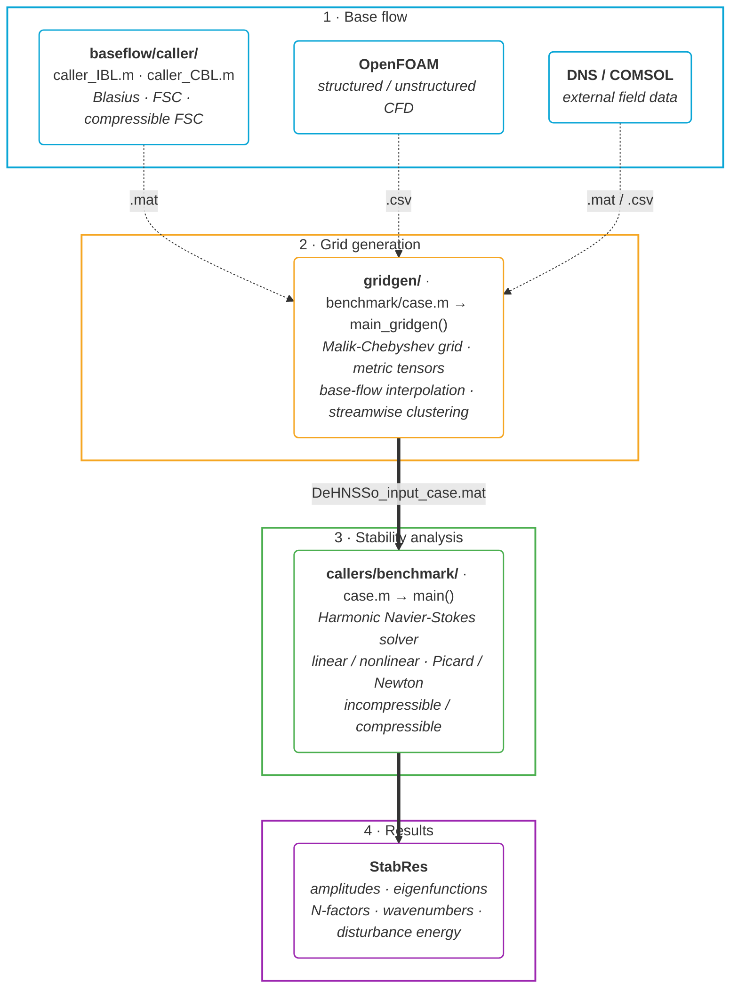

# DeHNSSo-v2

[](https://www.mathworks.com/products/matlab.html)
[](LICENSE)
[](docs/user_guide.md)
[](https://doi.org/10.1016/j.cpc.2024.109250)
[](#)
[](docs/user_guide.md)
[](src/external/)
[](docs/user_guide.md)

**Delft Harmonic Navier-Stokes Solver** — nonlinear stability analysis of laminar boundary layers over surfaces with complex geometric features.

DeHNSSo-v2 is an extended and refactored version of [DeHNSSo-v1](https://github.com/SvenWesterbeek/DeHNSSo) by Westerbeek, Hulshoff, Schuttelaars & Kotsonis (2024).

> **First draft (September 2026), paper in preparation.** For questions about the method or implementation, contact **Pietro Carlo Boldini** — P.C.Boldini@tudelft.nl

**Last updated:** 4 September 2026

---

## Recent updates (September 2026)

- **Inflow seeding rewritten** — `inflow.m` is one `switch` over `Stab.IC` with small per-mode helpers
- **Source restyled** — short description blocks and lean comments across `src/`, `gridgen/`, `baseflow/` and the callers
- **MUMPS diagnostics** — `Opt.newton_analyze_only` (analysis only) and back-solve timing in `Opt.newton_stats_file`
- **`Opt.xloc`** — station of the local energy measure; `Opt.iter_history` documented
- **Resonator benchmark** — Gaussian-clustered grid at the neck, Ma=0.061 base flow included

## Recent updates (August 2026)

- **Compressible Newton solver** — pseudo-arclength continuation in amplitude for the full (u, v, w, ρ, T) path, reaching high-amplitude states Picard cannot. Set `Opt.solver = 'newton'` with `Opt.newton_target`
- **Block-Thomas direct solver** — Paredes dual-Schur block-pentadiagonal factorization with out-of-core streaming, the memory-feasible path for large compressible systems (`Opt.lu_mode = 'block_thomas'`)
- **Banded-LU factor caching** — `lapack_band` now caches the banded factor and reuses it across Picard iterations (`Opt.lu_cache`)
- **PSE inflow** — seed the inflow with a linear-PSE (non-parallel) profile via `Stab.IC = 'PSE'`, or load precomputed modes with `Opt.pse_inflow`
- **Grid-first wall forcing** — define the actuator or wall-velocity distribution in gridgen (mesh refined around it) and apply it with `add_wall_forcing`; `Stab.IC = 'ZERO'` runs forcing-only cases
- **Helmholtz-resonator wall BC** — reactive impedance condition `v' − Y·p' = 0` over a resonator mouth (`Opt.hr`), with the streamwise mesh clustered at the neck; validated against Michelis (2023) (`callers/benchmark/resonator.m`)
- **`gridgen/src` reorganized** — split into role-based subfolders (`io`, `grid`, `resample`, `forcing`, `math`, `util`, `plot`)
- **`src/` reorganized** — inflow eigen-solvers split into `src/init/lst/` (`solver_ILST`, `solver_CLST`) and `src/init/pse/` (`solver_IPSE`, `solver_CPSE`), with per-mode seeding in `inflow.m`; boundary conditions under `src/boundary/`; direct linear-solver backends under `src/linsolve/` (`lapack_band/`, `block_thomas/`)
- **Bundled MUMPS 5.3.5** — under `src/external/` for the Newton factorizations
- and more

## Recent updates (June 2026)

- **`Opt.rerun` reuses the LU factorization cache** — amplitude/forcing sweeps on a fixed base flow now skip both assembly and factorization (~6× faster reuse). See [docs/user_guide.md](docs/user_guide.md) §9
- **Analytic base-flow derivatives as gridgen input** — supply them on the base flow to skip finite differencing (auto-detected per field); all base-flow differentiation now lives in gridgen. See [docs/user_guide.md](docs/user_guide.md) §3 (Step 1d)
- **Save run output** — `Opt.save_output` writes the final results to a git-ignored `output/` folder. See [docs/user_guide.md](docs/user_guide.md) §10

## Recent updates (May 2026)

- **Compressible mode** — full (u, v, w, ρ, T) HNS path (Scholten 2024). Validated against incompressible LST in the Ma → 0 limit (Bertolotti) and against the Zanus/Bertolotti 2017 PSE benchmarks at Ma=0.5, 1.6, and 4.5 (Ma=0.5 case shipped as `blasius_compressible`)
- **CBL solver** — compressible Falkner-Skan-Cooke similarity; new `baseflow/caller/` layout splits IBL and CBL entry points
- **Compressible callers** — `gridgen/benchmark/blasius_compressible.m` + `callers/benchmark/blasius_compressible.m` with built-in HNS vs Zanus/Bertolotti PSE plot
- **`lapack_band` LU mode** — LAPACK banded LU MEX (`src/linsolve/lapack_band/dgbsv_solve.c`), ~3× faster than `seq` on compressible TS. Build via `src/linsolve/lapack_band/mexbuild_dgbsv.m`
- **`block`/`band` LU modes removed** — `block` was silently wrong on ill-conditioned boundary stencils; `band` was redundant with `seq`
- **Docs** — `docs/user_guide.md` and `docs/developer_guide.md` updated for compressible mode and `lapack_band` MEX

## Recent updates (April 2026)

- **Validation status** — three reference cases from Westerbeek et al. 2024 reproduce end-to-end: nonlinear TS waves in a Blasius BL (Fig. 8), nonlinear stationary CFI on a swept-wing flat plate (Fig. 9), and linear stationary CFI over a smooth hump (Fig. 10). See [docs/reference_cases.md](docs/reference_cases.md) for replication instructions
- **New grid-generation pipeline** — flat-plate, body-fitted curvilinear, and unstructured CFD scatter (e.g. OpenFOAM)
- **Nonlinear solver** — AF-continuation Picard with damping, optional Anderson acceleration, and JFNK Newton fallback
- **Crossflow instability** — full M3J swept curved-wall case end-to-end
- **Non-uniform streamwise grids** — per-station Fornberg weights and sparse `D_xi`
- **Repository restructured** — `input/` + `literature/` split; per-case scripts under `*/benchmark/`

## Contents

- [Recent updates (September 2026)](#recent-updates-september-2026)
- [Recent updates (August 2026)](#recent-updates-august-2026)
- [Recent updates (June 2026)](#recent-updates-june-2026)
- [Recent updates (May 2026)](#recent-updates-may-2026)
- [Recent updates (April 2026)](#recent-updates-april-2026)
- [New features in DeHNSSo-v2](#new-features-in-dehnsso-v2)
    - [Geometry and mesh](#geometry-and-mesh)
    - [Boundary conditions](#boundary-conditions)
    - [Inflow](#inflow)
    - [Spectral content](#spectral-content)
    - [Solver modes](#solver-modes)
    - [Compressible mode](#compressible-mode)
    - [Computational efficiency](#computational-efficiency)
    - [Code quality](#code-quality)
- [Directory structure](#directory-structure)
- [Workflow](#workflow)
    - [1. Generate base flow](#1-generate-base-flow)
    - [2. Build stability grid](#2-build-stability-grid)
    - [3. Run stability analysis](#3-run-stability-analysis)
- [Key solver options](#key-solver-options)
- [Performance](#performance)
- [Documentation](#documentation)
- [Roadmap](#roadmap)
- [References](#references)
- [License](#license)

## New features in DeHNSSo-v2

### Geometry and mesh
- **Grid generation pipeline** (`gridgen/`) — builds structured Malik-Chebyshev stability grids and interpolates base-flow data; supports flat-plate similarity solutions, curvilinear body-fitted meshes, and external CFD imports (e.g., OpenFOAM)
- **Streamwise clustering** — Gaussian mesh refinement in the streamwise direction, concentrated around an actuator or geometric feature (e.g. a hump); available on flat-plate as well as curvilinear grids
- **Curvilinear coordinates** — perturbation equations formulated in general body-fitted coordinates (ξ, η) with numerically computed first- and second-order inverse metric tensors
- **Elliptic mesh smoother** — Laplace-based grid smoothing via successive over-relaxation, enabling body-fitted meshes on concave surfaces without grid folding

### Boundary conditions
- **Per-component freestream BC** — `Opt.bc_top` is a cell array `{'H_DR', 'H_DR', 'H_DR'}` specifying the BC type for each component independently (u, v, w, plus T for the compressible path):
  - `'H_DR'` — homogeneous Dirichlet (q = 0, default)
  - `'IH_DR'` — inhomogeneous Dirichlet (q = value from `Stab.bct`)
  - `'H_NM'` — homogeneous Neumann (dq/dy = 0)
  - `'free'` — unconstrained: keep the governing equation at `y = H` (no imposed BC), as used with the parabolization buffer
- **Wall actuation** — inhomogeneous Dirichlet BC at the wall (blowing/suction, streamwise or spanwise forcing). Define the actuator or an arbitrary wall-normal-velocity distribution in gridgen so the mesh clusters around it, then apply it in the caller with `add_wall_forcing` (amplitude and phase only); multiple actuators stack additively. Sets the underlying wall field `Stab.bcw`
- **Helmholtz-resonator wall** — reactive impedance BC `v' − Y·p' = 0` imposed over a resonator mouth via `Opt.hr` (`apply_resonator_wall`); models Helmholtz-resonator TS-wave control, with an optional free-slip `u'` over the mouth. The `(0,0)` mean flow keeps no-slip
- **Freestream forcing** — inhomogeneous Dirichlet BC at `y = H` (acoustic waves, free-stream turbulence) via `Stab.bct`; requires `'IH_DR'` on the forced component
- **Mixed BCs** — different BC types per component enable receptivity studies (e.g., `{'H_DR', 'IH_DR', 'H_DR'}` forces v at freestream while u and w decay to zero)
- **Backward compatible** — scalar `'dirichlet'` / `'neumann'` strings are auto-converted to the per-component format

### Inflow
- **Phase reference** — inflow eigenfunction phase can be referenced to wall pressure (`'pwall'`) or streamwise velocity maximum (`'umax'`) via `Stab.phaseRef`
- **Simplified amplitude interface** — set `Stab.A0_fund` (scalar) instead of manually building the full amplitude vector with `ModeToModeNumber`; conjugate pairs are built automatically in `init.m`

### Spectral content
- **3D support** — spanwise wavenumber modes (N > 0) fully supported for cross-flow instability analysis; beta-dependent LHS terms assembled as separate matrices (MLA3, MLA4) and combined at solve time

### Solver modes
- **Linear mode** — `Opt.linear = 'on'` disables nonlinear terms (NLT) and converges in a single iteration; equivalent to linear PSE. Default is `'off'` (nonlinear)
- **Picard** — default nonlinear solver: amplitude-factor continuation with damping and optional Anderson acceleration (`Opt.anderson`)
- **Newton** — `Opt.solver = 'newton'` runs pseudo-arclength continuation in the inflow amplitude to a target `Opt.newton_target`, reaching high-amplitude states Picard cannot; supported for both the incompressible and compressible paths

### Compressible mode
- **Compressible HNS** — `Opt.compressible = 'on'` activates the full (u, v, w, ρ, T) path (Scholten et al. 2024 density formulation). Pressure perturbation eliminated via the EOS; ρ is a direct state variable. Validated against incompressible LST (Bertolotti) in the Ma → 0 limit and against the Zanus/Bertolotti 2017 PSE M=0.5 benchmark; additional sanity tests at Ma=1.6 and Ma=4.5
- **Compressible base flow** — `baseflow/CBL/compressibleFSC.m` solves the compressible Falkner-Skan-Cooke similarity problem (adiabatic or isothermal walls, Sutherland viscosity)
- **Compressible inflow** — CLST eigenvalue solver with Mack F/S mode selection (`Opt.mode_select = 'slow' | 'fast'`) and continuous-spectrum branch rejection
- **Chu/Mack disturbance energy** — `Opt.plot_metric = 'energy'` plots √E with the compressible energy norm

### Computational efficiency
- **LHS matrix reuse** — pass the assembled LHS back across calls via `Opt.rerun = 'on'`; avoids full matrix reassembly for parameter sweeps (amplitude, actuation, frequency)
- **LU mode selection** — `Opt.lu_mode` picks the linear-solver strategy:
  - `'full'` — cache every LU factorization (default; fastest reuse, unbounded memory)
  - `'auto'` — LRU cache bounded by `Opt.lu_max_cache` (bounded memory)
  - `'lapack_band'` — LAPACK `zgbsv`/`dgbsv` MEX (banded LU with partial pivoting); ~2.8× faster on total wall (3.4× on the factorize-and-solve) than `seq` on the compressible TS benchmark, at half the peak memory, with per-mode factor caching (`Opt.lu_cache`) that further accelerates nonlinear runs. Build once via `src/linsolve/lapack_band/mexbuild_dgbsv.m`
  - `'block_thomas'` — Paredes dual-Schur block-pentadiagonal factorization, optionally out-of-core (`Opt.bt_ooc`); the memory-feasible path for large compressible systems
  - `'seq'` — one LU per mode group, discard after solve (low memory; required for compressible 5-var on tight RAM)
  - `'none'` — backslash each time (reference / debug)
- **Parallel assembly and solve** — `Opt.parfor = 'on'` parallelises LHS station assembly and mode solve (auto-detected; requires Parallel Computing Toolbox)
- **MFD_diff storage** — the mean-flow-distortion operator is stored as a difference from the fundamental LHS (`MLA1 + MFD_diff`) instead of a separate full matrix, cutting LHS memory
- **7.7x speedup** over DeHNSSo-v1 (Blasius test case, nx=800, ny=40, M=1)

### Code quality
- **Modular structure** — refactored from a monolithic 900-line function into focused, single-purpose files organised by role (`src/init`, `src/hns`, `src/newton`, `src/convergence`, `src/io`, `src/thermo`, `src/plot`, `src/math`)
- **Documented caller** — `callers/benchmark/blasius.m` is organised into labelled sections (spectral content, inflow, boundary conditions, buffer, solver options, performance, run, post-processing)

## Directory structure

```
DeHNSSo/
├── callers/
│   └── benchmark/               — Reference example callers (blasius.m, blasius_compressible.m, ...)
├── input/                       — Stability grid input, one per case (DeHNSSo_input_<case>.mat)
├── literature/                  — Reference data for validation plots (PSE, DNS, LPSE, Zanus/Bertolotti)
├── src/                         — Solver source code
│   ├── main.m                   — Main solver entry point
│   ├── init/                    — Initialization; inflow eigen-solvers in lst/ (solver_ILST/CLST) and pse/ (solver_IPSE/CPSE)
│   ├── boundary/                — Boundary conditions: wall forcing, resonator impedance, buffer setup
│   ├── hns/                     — Core HNS: LHS, LHS_compressible, RHS, NLT, mode indexing, solve dispatch
│   ├── linsolve/                — Direct linear-solver backends: lapack_band/ (banded LU MEX), block_thomas/
│   ├── newton/                  — Newton pseudo-arclength continuation solver
│   ├── convergence/             — Iteration control, amplitude damping, convergence checks
│   ├── thermo/                  — Sutherland viscosity (compressible)
│   ├── io/                      — Post-processing, configuration printing
│   ├── plot/                    — Intermediate, convergence, and final amplitude plots
│   ├── math/                    — Finite differences, Chebyshev operators
│   └── external/                — Bundled MUMPS 5.3.5 (Newton factorizations)
├── gridgen/                     — Grid generation and base-flow preprocessing
│   ├── main_gridgen.m           — Pipeline entry point
│   ├── benchmark/               — Per-case scripts: blasius.m, blasius_compressible.m, sweptwing_flat.m, ...
│   └── src/                     — Mesh, metric tensors, resampling (ρ/T pass-through), elliptic smoother
├── baseflow/                    — Boundary-layer solvers
│   ├── caller/                  — Entry points: caller_IBL.m, caller_CBL.m
│   ├── IBL/                     — Incompressible BL (Blasius, Falkner-Skan-Cooke)
│   ├── CBL/                     — Compressible BL (compressible FSC + Sutherland)
│   └── output/                  — Generated base flows (bf_blasius.mat, BF_compressible.mat, ...)
└── docs/                        — User guide and developer guide
```

## Workflow



### 1. Generate base flow

```matlab
cd baseflow/caller/
caller_IBL             % incompressible (Blasius, FSC) → baseflow/output/bf_blasius.mat
caller_CBL             % compressible (FSC + Sutherland) → baseflow/output/BF_compressible.mat
%   for blasius_newton: edit caller_IBL (domain to R = 1200, see gridgen/benchmark/blasius_newton.m) → bf_blasius_newton.mat
% compressible Ma=0.061 (Michelis, fine): base flow supplied as baseflow/output/benchmark/BF_compressible_M006_fine.mat
```

Or provide base-flow data from an external CFD solver (OpenFOAM, DNS, COMSOL, ...).

### 2. Build stability grid

The `gridgen/` pipeline builds the stability grid (Malik-Chebyshev wall-normal, FD streamwise) and interpolates the base flow onto it. Per-case scripts in `gridgen/benchmark/` configure the inputs and call `main_gridgen()`. Supported input types: Cartesian structured (`.mat`), curvilinear structured body-fitted (`.mat`), and unstructured CFD scatter (`.csv`).

```matlab
cd gridgen/benchmark/
blasius                 % Cartesian Blasius BL (.mat)
blasius_compressible    % Cartesian compressible FSC BL (.mat) — passes ρ/T/μ through
blasius_newton          % Cartesian Blasius BL resampled to the 1050 x 60 FD grid of the Newton benchmark
blasius_csv             % Cartesian Blasius BL from OpenFOAM CSV (flat-lattice scatter)
synthetic_jet           % Cartesian Blasius BL, mesh clustered at the jet orifice
resonator               % compressible Blasius BL, mesh clustered at the resonator neck
sweptwing_flat          % curvilinear flat-plate swept BL
sweptwing_hump          % curvilinear swept BL over a Gaussian hump
m3j                     % unstructured OpenFOAM scatter (M3J curved wall)
```

For dimensional CFD imports (e.g. OpenFOAM CSV) the cartesian path supports `params.rescale = true` with `Uref`/`lref` (X/Y divided by `lref`, U/V/W by `Uref` before interpolation), `params.interp_method` (`'makima'` default — handles non-uniform wall-clustered spacing without overshoot), and `params.xi_trim_inflow`/`xi_trim_outflow` for trimming noisy CFD BC regions. See [docs/user_guide.md](docs/user_guide.md) §1c.

Reference base-flow data lives in `baseflow/output/benchmark/` (committed; the rest of `baseflow/output/` stays a scratch area for `baseflow/caller/caller_IBL.m` and `caller_CBL.m` runs).

### 3. Run stability analysis

**First-time setup (optional).** If using the fastest LU mode `Opt.lu_mode = 'lapack_band'` (recommended for compressible TS), build the MEX once per machine:

```matlab
run('src/linsolve/lapack_band/mexbuild_dgbsv.m')   % needs MATLAB ≥ R2018a and a C compiler configured for mex
```

Otherwise the caller errors with a clear message; fall back to `Opt.lu_mode = 'seq'` if no compiler is available.

Per-case stability scripts in `callers/benchmark/` share an identical structure (Setup → Spectral content → Inflow → BCs → Buffer → Solver → Performance → Run → Post-processing) and differ only in case-specific parameter values:

```matlab
cd callers/benchmark/
blasius                 % TS waves in Blasius BL
blasius_compressible    % compressible TS waves (overlays Zanus/Bertolotti 2017 PSE M=0.5 reference)
blasius_newton          % Blasius K-type breakdown via Newton pseudo-arclength continuation
synthetic_jet           % synthetic-jet wall actuator on a Blasius TS wave
resonator               % Helmholtz-resonator impedance wall BC (TS control, Michelis 2023)
sweptwing_flat          % stationary CFI on flat-plate swept BL
sweptwing_hump          % stationary CFI over a hump on swept BL
m3j                     % stationary CFI on M3J curved swept-wing BL
```

## Key solver options

Set in the caller before calling `main()`:

| Parameter | Default | Description |
|---|---|---|
| `Stab.M` | — | Spectral truncation: temporal modes |
| `Stab.N` | — | Spectral truncation: spanwise modes |
| `Stab.omega_0` | — | Fundamental angular frequency |
| `Stab.beta_0` | — | Fundamental spanwise wavenumber |
| `Stab.IC` | — | Inflow (required): `'ILST'` (incompressible) / `'CLST'` (compressible) / `'PSE'` (non-parallel seed) / `'LOAD'` (warm-start) / `'ZERO'` (no inflow; disturbance from wall forcing only) |
| `Stab.A0_fund` | — | Fundamental mode amplitude (scalar) |
| `Opt.compressible` | `'off'` | Compressible mode: `'on'` activates (u,v,w,ρ,T) path |
| `Opt.bc_top` | `{'H_DR','H_DR','H_DR'}` | Freestream BC per component {u,v,w} (incompressible) or {u,v,w,T} (compressible) |
| `Opt.bc_wall_thermal` | `'isothermal'` | Wall thermal BC (compressible only) |
| `Opt.mode_select` | `'auto'` | Mack mode pick at Ma>1: `'slow'` / `'fast'` / `'auto'` |
| `Opt.buffer` | `'on'` | Buffer type: `'on'`, `'para'` (required at Ma>0), `'off'` |
| `Opt.xb` | 85 | Buffer start (% of domain) |
| `Opt.Conv` | `1e-4` | Convergence criterion |
| `Opt.solver` | `'picard'` | Nonlinear solver: `'picard'` or `'newton'` (pseudo-arclength continuation; needs `Opt.newton_target`) |
| `Opt.lu_mode` | `'full'` | LU strategy: `'lapack_band'` / `'block_thomas'` / `'full'` / `'auto'` / `'seq'` / `'none'` |
| `Opt.rerun` | `'off'` | Reuse LHS: `'on'` or `'off'` |
| `Opt.parfor` | auto | Parallel: `'on'` or `'off'` |
| `Opt.linear` | `'off'` | Linear mode: `'on'` or `'off'` |
| `Opt.plot` | `'on'` | Plots: `'on'` or `'off'` |
| `Opt.plot_metric` | `'umax'` | Amplitude metric: `'umax'` / `'urms'` / `'energy'` (Chu/Mack for compressible) |

See [docs/user_guide.md](docs/user_guide.md) for a full parameter reference.

## Performance

Blasius TS nonlinear (M=5, nx=800, ny=40, parallel execution disabled):

| Metric | DeHNSSo-v1 | DeHNSSo-v2 | ratio |
|---|---|---|---|
| LHS assembly | 8.84 s | 2.20 s | **4.0x** |
| Solve per mode, first | 5.54 s | 3.60 s | 1.5x |
| Solve per mode, repeat | 5.04 s | 0.10 s | **50x** |
| Total, nonlinear | 753 s | 39.9 s | **18.9x** |
| Operator storage | — | 112 MB | — |
| Cached LU factors | — | 6.24 GB | — |

Repeat solves are where the gain sits: the per-mode LU factor is computed once and reused for the
rest of the iteration, so the nonlinear loop stops paying for factorization.

SweptWing CFI nonlinear (M=0, N=5, six modes, nx=1200, ny=40, `lu_mode='auto'`, single-thread),
matching the DeHNSSo-v1 heritage caller (`xb=85`, `nltbufxb=80`, `A0=3.5e-3`, lambda=7.5 mm):

| Metric | DeHNSSo-v1 (Westerbeek 2024, Table A.1) | DeHNSSo-v2 (Apple M1 Pro, 32 GB) |
|---|---|---|
| Total time | 4644 s (1.29 h) | 247 s (**18.8x faster**) |
| Iterations | — | 67 Picard |
| Operator storage | — | 185 MB |

The back-end matters more than anything else on this case, and not in the obvious direction:

| `lu_mode` | total | solution `max(A)` |
|---|---|---|
| `auto` | 247 s | 0.3596 |
| `lapack_band` | 535 s | 0.3622 |
| `full` | 869 s | 0.3596 |

`full` keeps every factor resident, 16.3 GB of them, which on a 32 GB machine costs more in memory
pressure than it saves in refactorisation. `auto` bounds the cache and wins by 3.5x for an identical
solution. Prefer `full` only when the factors comfortably fit.

Compressible TS at Ma=0.5, linear (M=1, nx=800, ny=81, single thread on an Apple M1 Pro, 32 GB):

| Metric | `seq` (sparse LU) | `lapack_band` (MEX) | ratio |
|---|---|---|---|
| Total wall | 337 s | 129 s | **2.6x** |
| Operator storage | 186 MB | 186 MB | — |
| Banded factor | — | 19.7 GB | — |

Memory is reported as the operator and factor sizes, which are fixed by the discretization and
reproduce to the byte, rather than as peak resident memory, which on macOS depends on how the
allocator and compressor behave during the run.

The `block_thomas` back-end trades speed for memory: run out-of-core (`Opt.bt_ooc = 'on'`) it holds
the least in core, streaming the factor to disk, but runs slower than banded — the memory-feasible
path when even the banded factor exceeds RAM.

## Documentation

- [docs/user_guide.md](docs/user_guide.md) — how to configure and run cases
- [docs/developer_guide.md](docs/developer_guide.md) — code architecture, data structures, how to extend
- [docs/reference_cases.md](docs/reference_cases.md) — replication instructions for the three validated cases (Blasius TS, swept-wing flat CFI, swept-wing hump CFI)

## Roadmap

- **Discrete adjoint**
- **Compressible physics extensions**
- **HNS → PSE coupling**

Contact P.C.Boldini@tudelft.nl if interested in contributing.

## References

- S. Westerbeek, S. Hulshoff, H. Schuttelaars, M. Kotsonis. *DeHNSSo: The Delft Harmonic Navier-Stokes Solver for nonlinear stability problems with complex geometric features.* Computer Physics Communications 302, 109250 (2024). [DOI](https://doi.org/10.1016/j.cpc.2024.109250)

## License

GNU General Public License v3 — see [LICENSE](LICENSE).

DeHNSSo-v2 contains files from DeHNSSo-v1 (Copyright (C) 2023 S.H.J. Westerbeek,
S. Hulshoff, H. Schuttelaars and M. Kotsonis), which are GPLv3-licensed and carry
their own headers, and the differentiation-matrix suite of J.A.C. Weideman and
S.C. Reddy, included with their written permission. DeHNSSo-v2 is therefore
released under GPLv3.
