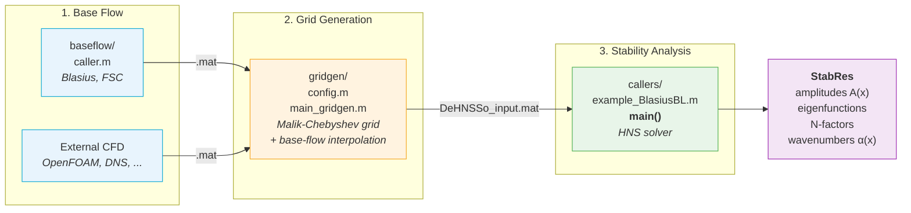

# DeHNSSo v2

**Delft Harmonic Navier-Stokes Solver** — nonlinear stability analysis of laminar boundary layers over surfaces with complex geometric features.

This is an extended and refactored version of [DeHNSSo](https://doi.org/10.1016/j.cpc.2024.109250) by Westerbeek, Hulshoff, Schuttelaars & Kotsonis (2024).

> **Paper in preparation.** For questions about the method or implementation, contact **Pietro Carlo Boldini** — P.C.Boldini@tudelft.nl

## New features in v2

### Geometry and mesh
- **Grid generation pipeline** (`gridgen/`) — builds structured Malik-Chebyshev stability grids and interpolates base-flow data; supports flat-plate similarity solutions, curvilinear body-fitted meshes, and external CFD imports (e.g., OpenFOAM)
- **Curvilinear coordinates** — perturbation equations formulated in general body-fitted coordinates (ξ, η) with numerically computed first- and second-order inverse metric tensors
- **Elliptic mesh smoother** — Laplace-based grid smoothing via successive over-relaxation, enabling body-fitted meshes on concave surfaces without grid folding

### Boundary conditions
- **Per-component freestream BC** — `Opt.bc_top` is a cell array `{'H_DR', 'H_DR', 'H_DR'}` specifying the BC type for each velocity component (u, v, w) independently:
  - `'H_DR'` — homogeneous Dirichlet (q = 0, default)
  - `'IH_DR'` — inhomogeneous Dirichlet (q = value from `Stab.bct`)
  - `'H_NM'` — homogeneous Neumann (dq/dy = 0)
- **Wall actuation** — inhomogeneous Dirichlet BC at the wall (blowing/suction, streamwise or spanwise forcing) via `Stab.bcw`
- **Freestream forcing** — inhomogeneous Dirichlet BC at `y = H` (acoustic waves, free-stream turbulence) via `Stab.bct`; requires `'IH_DR'` on the forced component
- **Mixed BCs** — different BC types per component enable receptivity studies (e.g., `{'H_DR', 'IH_DR', 'H_DR'}` forces v at freestream while u and w decay to zero)
- **Backward compatible** — scalar `'dirichlet'` / `'neumann'` strings are auto-converted to the per-component format

### Inflow
- **Phase reference** — inflow eigenfunction phase can be referenced to wall pressure (`'pwall'`) or streamwise velocity maximum (`'umax'`) via `Stab.phaseRef`
- **Simplified amplitude interface** — set `Stab.A0_fund` (scalar) instead of manually building the full amplitude vector with `ModeToModeNumber`; conjugate pairs are built automatically in `init.m`

### Spectral content
- **3D support** — spanwise wavenumber modes (N > 0) fully supported for cross-flow instability analysis; beta-dependent LHS terms assembled as separate matrices (MLA3, MLA4) and combined at solve time

### Solver modes
- **Linear mode** — `Opt.linear = 'on'` disables nonlinear terms (NLT) and converges in a single iteration; equivalent to linear PSE. Default is `'off'` (nonlinear)

### Computational efficiency
- **LHS matrix reuse** — pass the assembled LHS back across calls via `Opt.rerun = 'on'`; avoids full matrix reassembly for parameter sweeps (amplitude, actuation, frequency)
- **LU factorisation cache** — factorisations are cached per mode and reused across iterations; reused across runs when `omega`/`beta` are unchanged (`Opt.lu_mode`: `'full'`, `'auto'`, `'none'`)
- **Parallel assembly and solve** — `Opt.parfor = 'on'` parallelises LHS station assembly and mode solve (auto-detected; requires Parallel Computing Toolbox)
- **GPU acceleration** — `Opt.gpu = 'on'` solves on GPU via `gpuArray \`; beneficial for ny >= 80 on NVIDIA GPUs (auto-detected; requires PCT)
- **MFD_diff compression** — the mean-flow distortion LHS is stored as a difference matrix, reducing stored memory by 49%
- **7.7x speedup** over the heritage version (Blasius test case, nx=800, ny=40, M=1)

### Code quality
- **Modular structure** — refactored from a monolithic 900-line function into ~15 focused files organised by functionality (`src/init`, `src/hns`, `src/convergence`, `src/plot`, `src/math`)
- **Documented caller** — `callers/example_BlasiusBL.m` is organised into labelled sections (spectral content, inflow, boundary conditions, buffer, solver options, performance, run, post-processing)

## Directory structure

```
DeHNSSo/
├── callers/
│   └── example_BlasiusBL.m      — Example: TS waves in Blasius BL
├── stability/
│   ├── DeHNSSo_input.mat        — Stability grid input (generated by gridgen/)
│   └── literature/              — Reference data (PSE, DNS, LPSE)
├── src/                         — Solver source code
│   ├── main.m                   — Main solver entry point
│   ├── init/                    — Initialisation, inflow, boundary conditions, ILST
│   ├── hns/                     — Core HNS: LHS assembly, RHS, solve, NLT
│   ├── convergence/             — Iteration control, amplitude damping, convergence checks
│   ├── io/                      — Post-processing, configuration printing
│   ├── plot/                    — Intermediate, convergence, and final amplitude plots
│   └── math/                    — Finite differences, Chebyshev operators
├── gridgen/                     — Grid generation and base-flow preprocessing
│   ├── main_gridgen.m           — Pipeline entry point
│   ├── config.m                 — User configuration (Re, nx, ny, H, y_i)
│   └── src/                     — Mesh generation, metric computation, elliptic smoother
├── baseflow/                    — Boundary-layer solver (Blasius, Falkner-Skan-Cooke)
└── docs/                        — User guide and developer guide
```

## Workflow



### 1. Generate base flow

```matlab
cd baseflow/
caller          % generates BF_Blasius.mat in baseflow/output/
```

Or provide base-flow data from an external CFD solver (OpenFOAM, DNS, COMSOL, ...).

### 2. Build stability grid

The `gridgen/` pipeline builds the stability grid (Malik-Chebyshev wall-normal, FD streamwise) and interpolates the base flow onto it.

```matlab
cd gridgen/
edit config.m   % set grid parameters, Re, domain height
main_gridgen    % reads ../baseflow/output/, saves DeHNSSo_input.mat to ../stability/
```

### 3. Run stability analysis

```matlab
cd callers/
example_BlasiusBL   % runs DeHNSSo, plots amplitude development
```

## Key solver options

Set in the caller before calling `main()`:

| Parameter | Default | Description |
|---|---|---|
| `Stab.M` | — | Spectral truncation: temporal modes |
| `Stab.N` | — | Spectral truncation: spanwise modes |
| `Stab.omega_0` | — | Fundamental angular frequency |
| `Stab.beta_0` | — | Fundamental spanwise wavenumber |
| `Stab.IC` | `'ILST'` | Inflow method: `'ILST'` or `'LOAD'` |
| `Stab.A0_fund` | — | Fundamental mode amplitude (scalar) |
| `Opt.bc_top` | `{'H_DR','H_DR','H_DR'}` | Freestream BC per component {u, v, w} |
| `Opt.buffer` | `'on'` | Buffer type: `'on'`, `'para'`, `'off'` |
| `Opt.xb` | 85 | Buffer start (% of domain) |
| `Opt.Conv` | `1e-4` | Convergence criterion |
| `Opt.lu_mode` | `'full'` | LU cache: `'full'`, `'auto'`, `'none'` |
| `Opt.rerun` | `'off'` | Reuse LHS: `'on'` or `'off'` |
| `Opt.parfor` | auto | Parallel: `'on'` or `'off'` |
| `Opt.gpu` | auto | GPU solve: `'on'` or `'off'` |
| `Opt.linear` | `'off'` | Linear mode: `'on'` or `'off'` |
| `Opt.plot` | `'on'` | Plots: `'on'` or `'off'` |

See [docs/user_guide.md](docs/user_guide.md) for a full parameter reference.

## Performance

Blasius BL test case (nx=800, ny=40, M=1, sequential):

| Metric | Heritage | v2 |
|---|---|---|
| Total time | 194.7 s | 25.2 s (**7.7x faster**) |
| LHS stored memory | 224.4 MB | 115.4 MB (**49% less**) |
| Non-LHS memory | 54.4 MB | 10.6 MB (**5.1x less**) |

For the nonlinear case (M=5): heritage 785.8 s -> v2 88.5 s (**8.8x faster**).

## Documentation

- [docs/user_guide.md](docs/user_guide.md) — how to configure and run cases
- [docs/developer_guide.md](docs/developer_guide.md) — code architecture, data structures, how to extend

## Roadmap

- **Grid generation** — curvilinear meshes from external CFD solvers (in progress)
- **Discrete adjoint** — receptivity and sensitivity analysis (in progress)
- **Compressible extension** — (rho, u, v, w, T) for high-speed boundary layers (planned)

Contact P.C.Boldini@tudelft.nl if interested in contributing.

## References

- S. Westerbeek, S. Hulshoff, H. Schuttelaars, M. Kotsonis. *DeHNSSo: The Delft Harmonic Navier-Stokes Solver for nonlinear stability problems with complex geometric features.* Computer Physics Communications 302, 109250 (2024). [DOI](https://doi.org/10.1016/j.cpc.2024.109250)

## License

MIT License — see [LICENSE](LICENSE).
